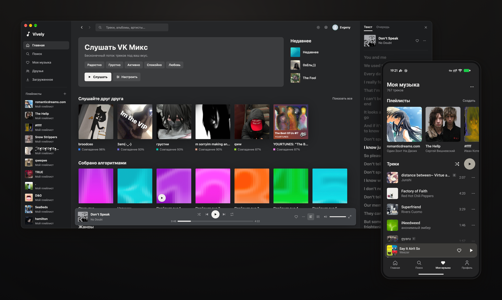

# Vively


A native VK Music client for macOS, Windows, Linux, and Android, built around a shared Rust core.



## Features

### Desktop

Native app for macOS, Windows, and Linux built with Rust and GPUI.

- Sign in with QR code, phone OTP, or password, with 2FA and captcha handling
- VK Mix with mood filters, recommendations, search history, artist pages, albums, and friends' music
- Library and playlists: create and edit playlists, upload covers, and broadcast the current track to VK status
- Crossfade up to 12 seconds, queue management, shuffle, and repeat
- Synced and plain lyrics from VK with Musixmatch and Genius fallback
- Offline downloads and auto-cache with configurable storage limits
- System media controls (macOS Now Playing, Windows SMTC, Linux MPRIS)
- Dark, light, and system themes

### Android

Native Jetpack Compose app sharing the same Rust core through UniFFI. Android 8.0 or later.

- Background playback through Media3 with lock-screen controls and audio focus handling
- Offline downloads, auto-cache, and a Wi-Fi-only download option
- Dynamic accent colors from track artwork or Android system wallpaper colors
- Same library, VK Mix, synced lyrics, queue, crossfade, and sign-in flows as desktop

## Build

### Desktop

```sh
# macOS (builds target/release/Vively.app; pass "install" to copy to /Applications)
bash scripts/build.sh mac

# Linux (install Debian/Ubuntu build dependencies first)
sudo bash scripts/linux-build-deps.sh
bash scripts/build.sh linux

# Windows
cargo build --release --locked -p vively
```

### Android

Requires Android NDK 28, `cargo-ndk`, and the `aarch64-linux-android` Rust target.

```sh
cd android
./gradlew :app:assembleRelease
```

Release signing reads `android/keystore.properties` (`storeFile`, `storePassword`, `keyAlias`, `keyPassword`) or the `ANDROID_KEYSTORE_PATH`, `ANDROID_KEYSTORE_PASSWORD`, `ANDROID_KEY_ALIAS`, and `ANDROID_KEY_PASSWORD` environment variables.

## Architecture

- `crates/vively-core` handles VK API requests, authentication, HLS AES-128 decryption, lyrics lookup, and the SQLite download store.
- `crates/vively-audio` runs audio decoding and playback with `rodio`, crossfade, stream buffering, and desktop OS media controls.
- `crates/vively-app` holds shared application state, navigation, and actions.
- `crates/vively` is the GPUI desktop interface.
- `crates/vively-ffi` and `android/` expose the shared core over UniFFI to the Jetpack Compose Android app.

## License

[MIT](LICENSE).
